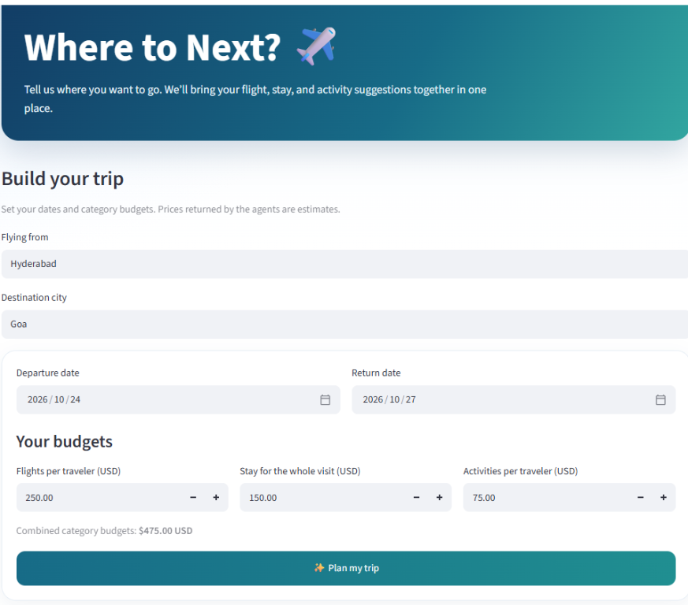
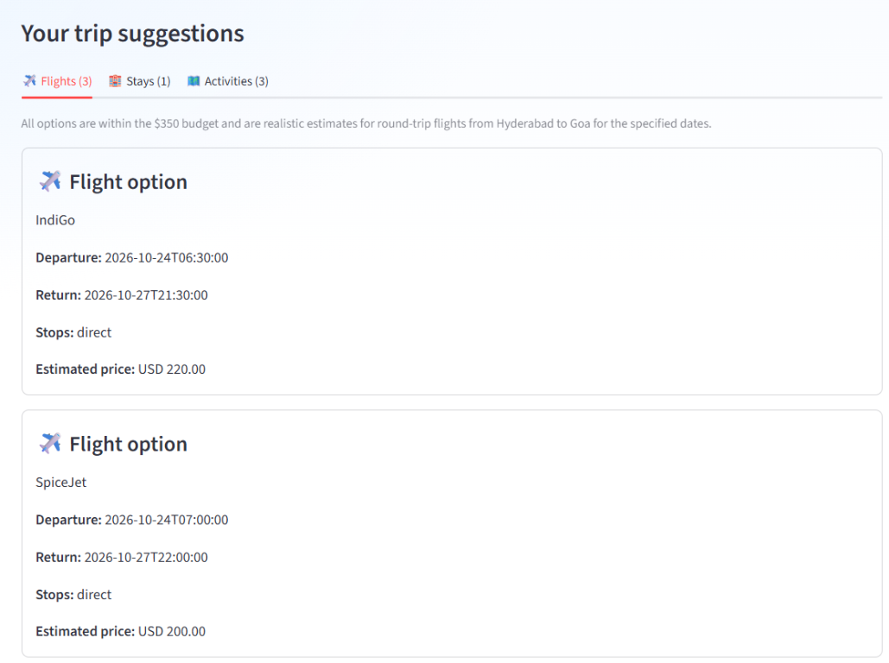
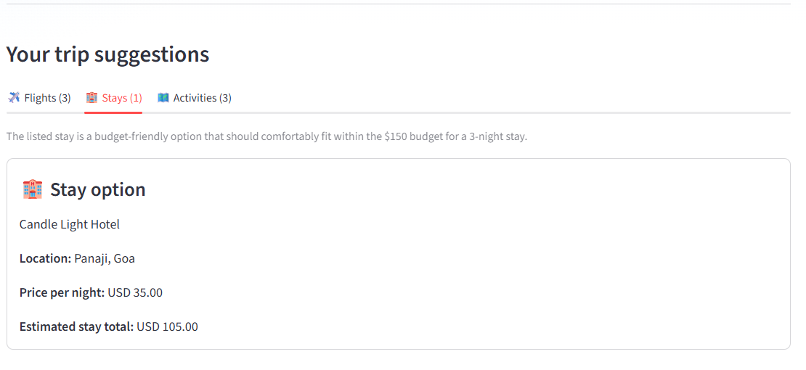
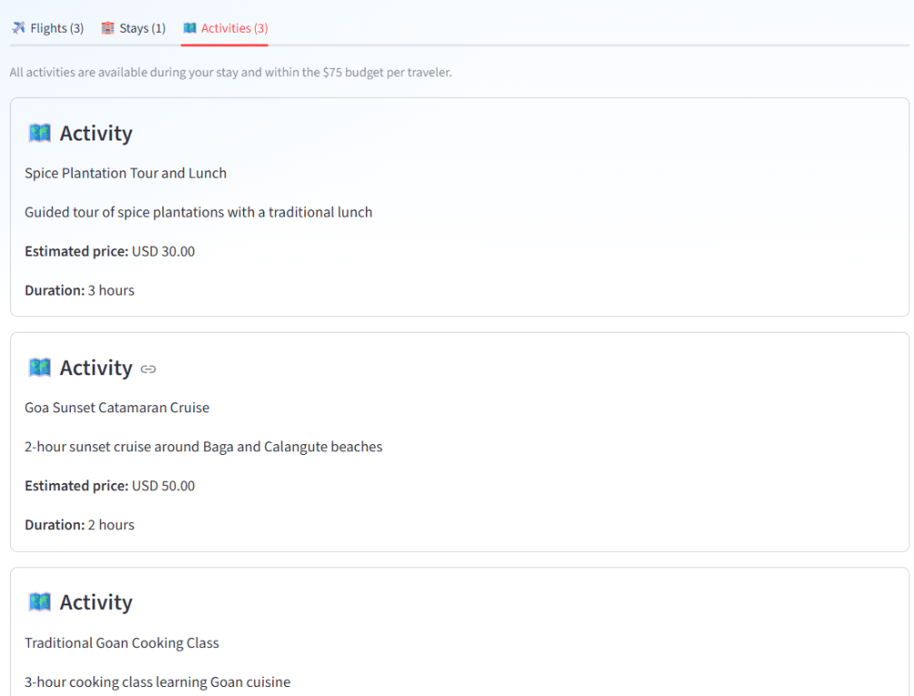

# Where to Next? - Multi-Agent Travel Planner

An AI-powered travel-planning demo that collects a trip's origin, destination,
dates, and category budgets, then displays flight, stay, and activity
suggestions in a responsive Streamlit interface.

> **Important:** Suggestions and prices are generated by an AI model. They are
> estimates, not live inventory, confirmed bookings, or guaranteed prices.
> Verify details with travel providers before making plans.

## Demo

The screenshots below show a sample trip from Hyderabad to Goa for
October 24-27, 2026. Results can vary between requests because they are
AI-generated.

### Trip details



### Flight suggestions



### Stay suggestion



### Activity suggestions



## Features

- Separate budgets for flights, accommodation, and activities.
- Three dedicated AI agents for flights, stays, and activities.
- A host API that requests the agents concurrently and returns a unified result.
- Structured response validation and readable result cards in Streamlit.
- Input validation for locations, dates, and non-negative budgets.

## Architecture

```text
Streamlit UI (8501)
       |
       v
Host API (8000)
       |
       +---- Flight agent API (8001)
       +---- Stay agent API (8002)
       +---- Activities agent API (8003)
```

Each specialist uses Google ADK with LiteLLM and the configured Groq model.
The host's task manager calls all three specialist APIs and combines their
structured responses.

## Requirements

- Python 3.13 (see `.python-version`)
- [`uv`](https://docs.astral.sh/uv/getting-started/installation/)
- A Groq API key for the configured model

## Setup

Run these commands from the project root in PowerShell:

```powershell
uv sync
```

Create a `.env` file in the project root with your API key:

```dotenv
GROQ_API_KEY=your_groq_api_key
```

Keep `.env` private. It is ignored by Git; do not commit or share the key.
If a key is ever exposed, revoke it with the provider and create a replacement.

## Run the application

Start each service in its own PowerShell terminal from the project root.
Activate the environment in each terminal, or run the executable directly.

**Terminal 1 - host API**

```powershell
uv run uvicorn agents.host_agent.__main__:app --host 127.0.0.1 --port 8000
```

**Terminal 2 - flight agent**

```powershell
uv run uvicorn agents.flight_agent.__main__:app --host 127.0.0.1 --port 8001
```

**Terminal 3 - stay agent**

```powershell
uv run uvicorn agents.stay_agent.__main__:app --host 127.0.0.1 --port 8002
```

**Terminal 4 - activities agent**

```powershell
uv run uvicorn agents.activities_agent.__main__:app --host 127.0.0.1 --port 8003
```

**Terminal 5 - Streamlit UI**

```powershell
uv run streamlit run travel_ui.py --server.port 8501
```

Open [http://localhost:8501](http://localhost:8501) in your browser. Start the
four APIs before submitting a trip request in the UI.

## API request example

The host exposes `POST /run` on port 8000. Its request body is:

```json
{
  "origin": "Hyderabad",
  "destination": "Goa",
  "start_date": "2026-10-24",
  "end_date": "2026-10-27",
  "flight_budget": 250,
  "stay_budget": 150,
  "activity_budget": 75
}
```

The response contains `flights`, `stays`, and `activities`. Each section has
an `options` list and a `note`. Price values are estimates in USD.

## Project layout

```text
agents/
  activities_agent/   Activities specialist API and ADK agent
  flight_agent/       Flight specialist API and ADK agent
  host_agent/         Host API and specialist orchestration
  stay_agent/         Stay specialist API and ADK agent
common/               Shared FastAPI server and HTTP client
docs/screenshots/     Screenshots used in this README
shared/               Request schema and agent output validation
travel_ui.py          Streamlit application
pyproject.toml         Project dependencies and metadata
uv.lock               Locked dependency versions
```

## Current limitations

- Flight, stay, and activity suggestions are model-generated and are not
  retrieved from live travel providers.
- Prices, schedules, availability, and venue details may be inaccurate or
  change. Confirm them independently before booking.
- The model may occasionally return malformed or inconsistent output; the
  application validates response structure, but validation cannot confirm
  that recommendations are factually correct.
- The APIs are configured for local development and are not production-hardened.